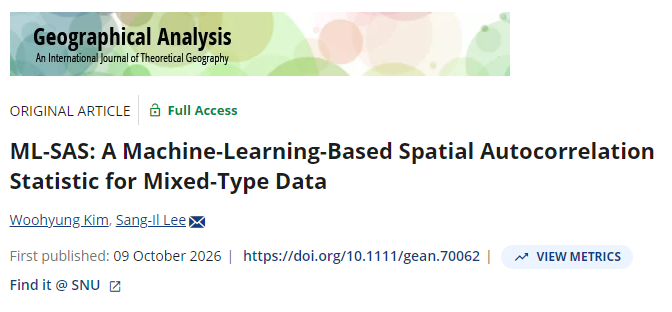

## New Publication in Geographical Analysis: Introducing ML-SAS

We are pleased to announce that <strong>Woohyung Kim</strong> and **Professor Sang-Il Lee** have published a paper in the international journal *Geographical Analysis*!

Their paper, titled [**"ML-SAS: A Machine-Learning-Based Spatial Autocorrelation Statistic for Mixed-Type Data,"**](https://doi.org/10.1111/gean.70062) proposes a novel spatial autocorrelation statistic that integrates machine learning with spatial statistical analysis. By utilizing unsupervised random forests, the proposed method enables the joint analysis of continuous and categorical variables, offering a new approach to identifying complex spatial patterns. Through simulation experiments and an empirical application to Dutch municipalities, the study demonstrates the potential of ML-SAS for analyzing multivariate spatial relationships.

We sincerely applaud their hard work and dedication throughout the research process. Congratulations once again to both authors on this wonderful achievement!

^**Reference**^

^Kim, W., and S.-I. Lee. 2026. “ML-SAS: A Machine-Learning-Based Spatial Autocorrelation Statistic for Mixed-Type Data.” *Geographical Analysis* 58, no. 4: e70062.^

  <a href="../index.html" class="news-back-btn">← View all posts</a>

