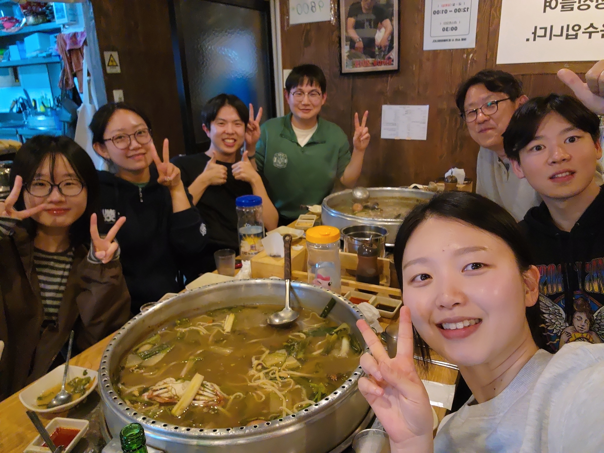

{fig-align="center" width="581"}

## The 2026 Winter Season Begins at "Sook's Clam Hot Pot"! 🦪

Our 2026 winter season at **"Sook's Clam Hot Pot"** has officially begun!!

To celebrate the end of the midterm exam for 'Spatial Data Analysis and Geography Education (Spatial Interaction Data Analysis)', our lab gathered for a well-deserved dinner together.

The crisp autumn breeze, a steaming pot of clam hot pot, and exam papers finally out of our hands - three ingredients for a perfectly unforgettable harmony! 🍂

Until we meet again for [**the FINAL EXAM...**]{style="color: red;"}

To be continued!! 🤓💦

  <a href="../index.html" class="news-back-btn">← View all posts</a>

