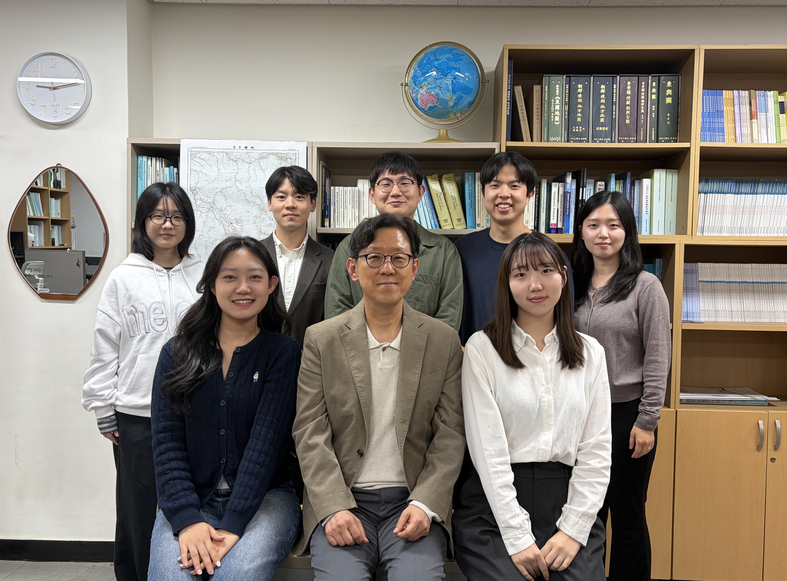
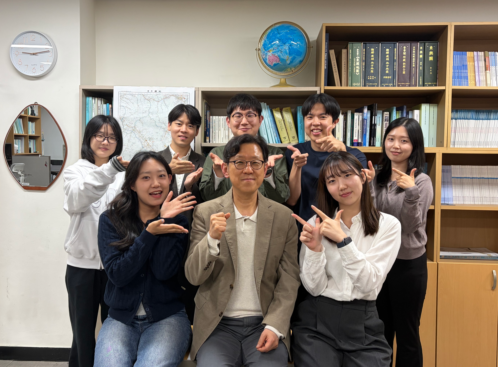
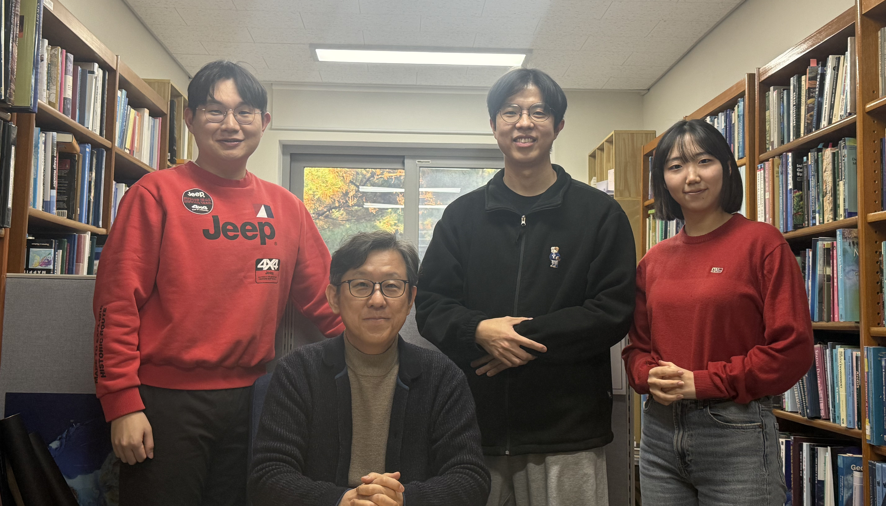
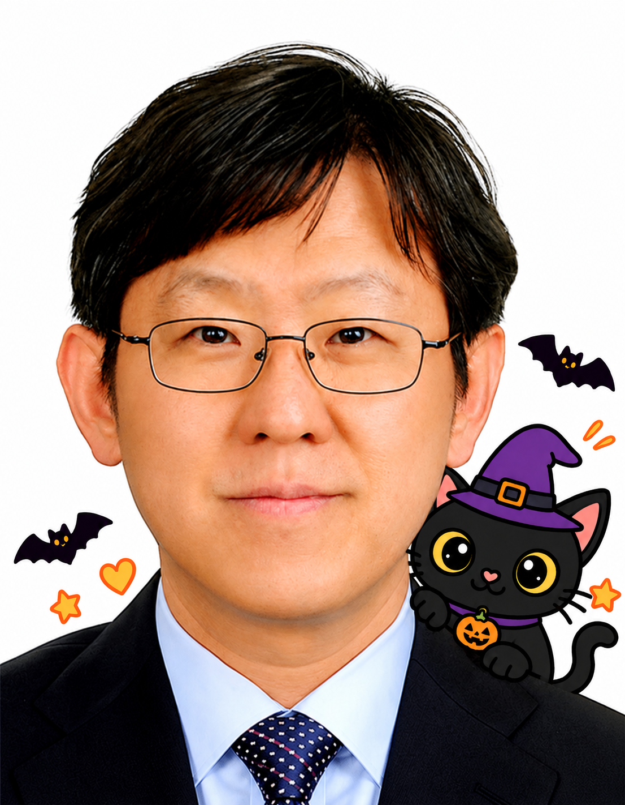
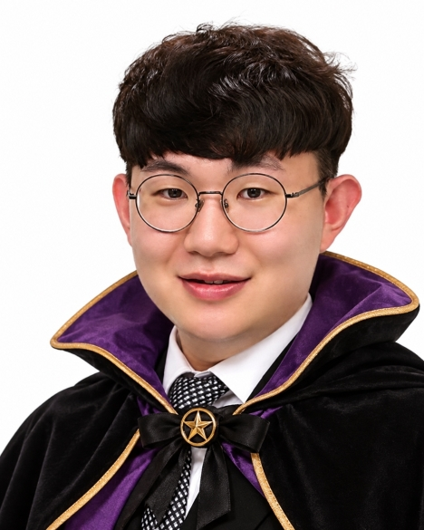
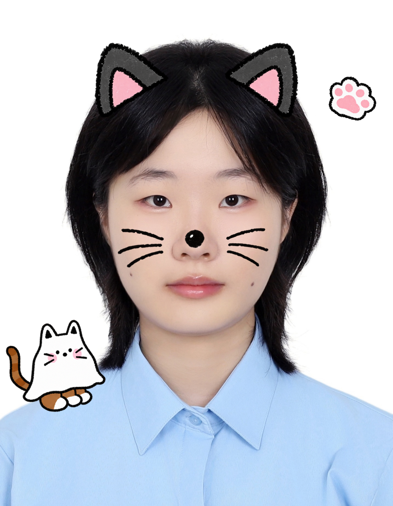
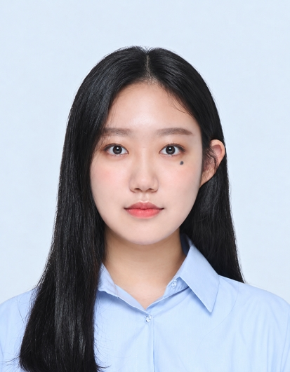
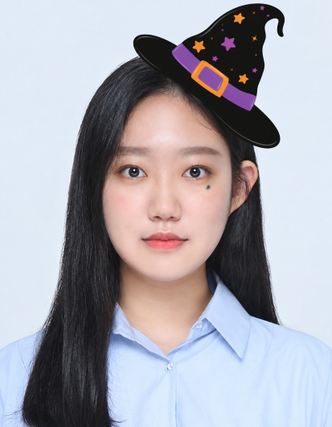
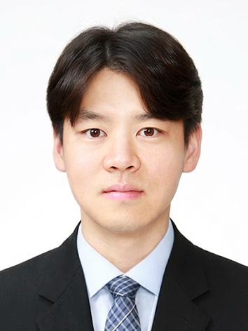
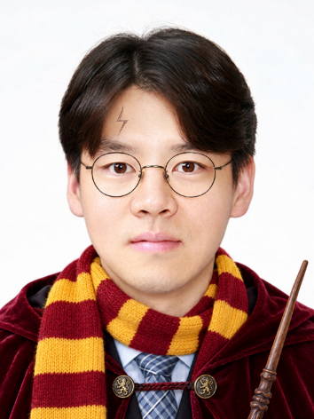

::: {.team-hero-card}

```{=html}
<div class="team-hero-slideshow">
  
  
  
</div>

<script>
document.addEventListener("DOMContentLoaded", function () {
  const slides = document.querySelectorAll(".team-hero-slideshow .team-hero-img");
  let currentSlide = 0;

  if (slides.length < 2) return;

  setInterval(function () {
    slides[currentSlide].classList.remove("slide-active");

    currentSlide = (currentSlide + 1) % slides.length;

    slides[currentSlide].classList.add("slide-active");
  }, 3000);
});
</script>
```

:::


## Professor

::: {.professor-layout}

<div class="prof-left">
  <button class="prof-photo-flip" type="button"
          aria-label="교수님 사진 뒤집기" aria-pressed="false"
          onclick="this.classList.toggle('is-flipped'); this.setAttribute('aria-pressed', this.classList.contains('is-flipped'));">
    <span class="prof-photo-flip-inner">
      <span class="prof-photo-flip-front">
        
        
      </span>
      
    </span>
  </button>
</div>

<div class="prof-right">

### Sang-Il Lee

**Office**: [Room 319, Building 10, College of Education, Seoul National University](https://www.google.com/maps?q=37.460373,126.955093)

🎓 Ph.D. in Geography, The Ohio State University  
🎓 M.A. in Geography Education, Seoul National University  
🎓 B.A. in Geography Education, Seoul National University  

#### 📖 **Research Interests**
- Spatial Data Science  
- Spatial Data Analysis and Spatial Statistics  
- Cartography and GeoVisualization  
- Geographic Information Systems (GIS)  
- Population Geography and Spatial Demography  
- Geography of Education  

<div class="profile-icons">
  <a href="https://scholar.google.com/citations?hl=ko&user=gb4QsEQAAAAJ" target="_blank">
    
  </a>

  <a href="https://sangillee.snu.ac.kr/" target="_blank">
    
  </a>
</div>

</div>
:::

## Master Students

<div class="member-grid">

<!-- Open Each Person Card -->
<div class="member-card">
<div class="lee-photo-swap">
  
  
</div>
<div class="member-info">
<h3>Minseop Jeong</h3>
<div class="member-role">M.A. Student</div>
<div class="badge-container">
<span class="badge">Population Geography</span>
</div>

<div class="member-icons">
<a href="https://mail.google.com/mail/?view=cm&fs=1&to=jms7061@snu.ac.kr" target="_blank" aria-label="Email">

</a>
<a href=" " target="_blank" aria-label="Homepage">

</a>
</div>
</div>
</div>
<!-- Close Each Person Card -->

<div class="member-card">
<div class="lee-photo-swap">
  
  
</div>
<div class="member-info">
<h3>Seowoo Park</h3>
<div class="member-role">M.A. Student</div>
<div class="badge-container">
<span class="badge">Spatial Data Science</span>
<span class="badge">Remote sensing</span>
</div>

<div class="member-icons">
<a href="https://mail.google.com/mail/?view=cm&fs=1&to=seowoo0805@snu.ac.kr" target="_blank" aria-label="Email">

</a>
<a href="https://seowoo-85.github.io/" target="_blank" aria-label="Homepage">

</a>
</div>
</div>
</div>

<div class="member-card">
<div class="lee-photo-swap">
  
  
</div>
<div class="member-info">
<h3>Sori Yun</h3>
<div class="member-role">M.A. Student</div>
<div class="badge-container">
<span class="badge">Spatial Data Science</span>
</div>

<div class="member-icons">
<a href="https://mail.google.com/mail/?view=cm&fs=1&to=sound722@snu.ac.kr" target="_blank" aria-label="Email">

</a>
<a href=" " target="_blank" aria-label="Homepage">

</a>
</div>
</div>
</div>

<div class="member-card">
<div class="lee-photo-swap">
  
  
</div>
<div class="member-info">
<h3>Yifan Dai</h3>
<div class="member-role">M.A. Student</div>
<div class="badge-container">
<span class="badge">GIS</span>
<span class="badge">Machine Learning</span>
</div>

<div class="member-icons">
<a href="https://mail.google.com/mail/?view=cm&fs=1&to=yif_daii0205@snu.ac.kr" target="_blank" aria-label="Email">

</a>
<a href=" " target="_blank" aria-label="Homepage">

</a>
</div>
</div>
</div>

<div class="member-card">
<div class="lee-photo-swap">
  
  
</div>
<div class="member-info">
<h3>Dahyun Lee</h3>
<div class="member-role">M.A. Student</div>
<div class="badge-container">
<span class="badge">Spatial Data Science</span>
<span class="badge">Geography Education</span>
</div>

<div class="member-icons">
<a href="https://mail.google.com/mail/?view=cm&fs=1&to=ldh0821@snu.ac.kr" target="_blank" aria-label="Email">

</a>
<a href="https://blog.naver.com/all_poem169" target="_blank" aria-label="Homepage">

</a>
</div>
</div>
</div>

<div class="member-card">
<div class="lee-photo-swap">
  
  
</div>
<div class="member-info">
<h3>Hansung Kim</h3>
<div class="member-role">M.A. Student</div>
<div class="badge-container">
<span class="badge">Spatial Data Science</span>
<span class="badge">Geography Education</span>
</div>

<div class="member-icons">
<a href="https://mail.google.com/mail/?view=cm&fs=1&to=gkstjd96@snu.ac.kr" target="_blank" aria-label="Email">

</a>
<a href=" " target="_blank" aria-label="Homepage">

</a>
</div>
</div>
</div>

</div> <!-- close Master Students --> 

## Alumni


<style>
/* Alumni: 이름과 졸업 정보 정렬 */
.alumni-list .alumni-entry {
  display: grid;
  grid-template-columns: 160px minmax(0, 1fr);
  align-items: baseline;
  column-gap: 12px;
}

.alumni-list .alumni-name {
  font-weight: 700;
}

.alumni-list .alumni-degree {
  font-weight: 700;
}

/* 모바일 화면 대응 */
@media (max-width: 520px) {
  .alumni-list .alumni-entry {
    grid-template-columns: 135px minmax(0, 1fr);
    column-gap: 8px;
  }
}
</style>

<ul class="alumni-list">
  <li><div class="alumni-entry"><span class="alumni-name">Hyekyeong Nam</span><span class="alumni-degree">(M.A., 2026)</span></div></li>
  <li><div class="alumni-entry"><span class="alumni-name">Woohyung Kim</span><span class="alumni-degree">(M.A., 2026)</span></div></li>
  <li><div class="alumni-entry"><span class="alumni-name">Hyemin Jeon</span><span class="alumni-degree">(M.A., 2025)</span></div></li>
  <li><div class="alumni-entry"><span class="alumni-name">Sechang Kim</span><span><strong>(M.A., 2023)</strong>: Ph.D. Student at University of Washington</span></div></li>
  <li><div class="alumni-entry"><span class="alumni-name">Yongmin Kim</span><span class="alumni-degree">(M.A., 2022)</span></div></li>
  <li><div class="alumni-entry"><span class="alumni-name">Dong-han You</span><span class="alumni-degree">(M.A., 2022)</span></div></li>
  <li><div class="alumni-entry"><span class="alumni-name">Jihee Park</span><span class="alumni-degree">(M.A., 2007; Ph.D., 2021)</span></div></li>
  <li><div class="alumni-entry"><span class="alumni-name">Soyoung Lee</span><span class="alumni-degree">(Ph.D., 2020)</span></div></li>
  <li><div class="alumni-entry"><span class="alumni-name">Lei Zhu</span><span class="alumni-degree">(Ph.D., 2019)</span></div></li>
  <li><div class="alumni-entry"><span class="alumni-name">Changwoo Jeon</span><span class="alumni-degree">(M.A., 2017)</span></div></li>
  <li><div class="alumni-entry"><span class="alumni-name">Nam-Seung Lee</span><span class="alumni-degree">(M.A., 2016)</span></div></li>
  <li><div class="alumni-entry"><span class="alumni-name">Changho Lee</span><span class="alumni-degree">(M.A., 2015)</span></div></li>
  <li><div class="alumni-entry"><span class="alumni-name">Jong-il Lee</span><span class="alumni-degree">(M.A., 2013)</span></div></li>
  <li><div class="alumni-entry"><span class="alumni-name">Mong-hyeon Lee</span><span class="alumni-degree">(M.A., 2012)</span></div></li>
  <li><div class="alumni-entry"><span class="alumni-name">Young JaeGal</span><span class="alumni-degree">(M.A., 2012)</span></div></li>
  <li><div class="alumni-entry"><span class="alumni-name">Jin-hyuk Kim</span><span class="alumni-degree">(M.A., 2011)</span></div></li>
  <li><div class="alumni-entry"><span class="alumni-name">Doe-seung Choi</span><span class="alumni-degree">(M.A., 2011)</span></div></li>
  <li><div class="alumni-entry"><span class="alumni-name">Gyeongmo Choo</span><span class="alumni-degree">(M.A., 2011)</span></div></li>
  <li><div class="alumni-entry"><span class="alumni-name">Hyeongmo Koo</span><span class="alumni-degree">(M.A., 2010)</span></div></li>
  <li><div class="alumni-entry"><span class="alumni-name">Yongha Park</span><span class="alumni-degree">(M.A., 2010)</span></div></li>
  <li><div class="alumni-entry"><span class="alumni-name">Hyo-jin Kim</span><span class="alumni-degree">(M.A., 2008)</span></div></li>
  <li><div class="alumni-entry"><span class="alumni-name">Yu-jung Lee</span><span class="alumni-degree">(M.A., 2008)</span></div></li>
  <li><div class="alumni-entry"><span class="alumni-name">E-bin Cho</span><span class="alumni-degree">(M.A., 2008)</span></div></li>
  <li><div class="alumni-entry"><span class="alumni-name">Ji-eun Han</span><span class="alumni-degree">(M.A., 2002; Ph.D., 2008)</span></div></li>
  <li><div class="alumni-entry"><span class="alumni-name">Jaehyun Kim</span><span class="alumni-degree">(M.A., 2007)</span></div></li>
  <li><div class="alumni-entry"><span class="alumni-name">Kyung-sun Lee</span><span class="alumni-degree">(M.A., 2007)</span></div></li>
  <li><div class="alumni-entry"><span class="alumni-name">Daeheon Cho</span><span class="alumni-degree">(M.A., 2001; Ph.D., 2007)</span></div></li>
  <li><div class="alumni-entry"><span class="alumni-name">Tae-ho Kim</span><span class="alumni-degree">(M.A., 2004)</span></div></li>
  <li><div class="alumni-entry"><span class="alumni-name">Jae-youl Lee</span><span class="alumni-degree">(M.A., 2001)</span></div></li>
</ul>


## Join Our Lab

If you are interested in joining our lab, please feel free to contact us!

**Contact**: [si_lee@snu.ac.kr](mailto:si_lee@snu.ac.kr)
